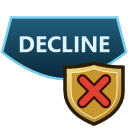
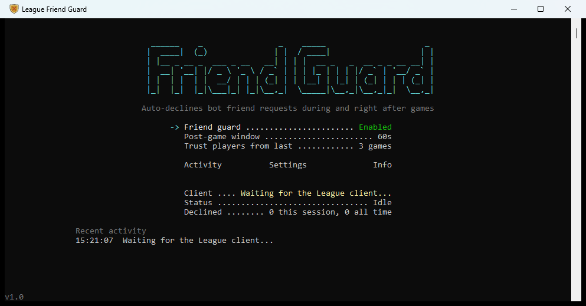

<p align="center">
  
</p>

<h1 align="center">League Friend Guard</h1>

<p align="center">
  Automatically declines the bot friend requests that show up during League of Legends games,<br>
  without touching requests from people you actually played with.
</p>

<p align="center">
  <a href="https://github.com/overbakedtoast/LeagueFriendGuard/releases/latest"></a>
  
  
  <a href="LICENSE"></a>
</p>

<p align="center">
  <em>Inspired by and modeled on <a href="https://github.com/sweetriverfish/LeagueAutoAccept">LeagueAutoAccept</a> by sweetriverfish. See <a href="#credits">Credits</a>.</em>
</p>

---

## Why

Mid-game, a friend request pops up from an account you've never seen: a fresh, random name that wasn't in your lobby. These are bots, and they come often enough to be an annoyance. Declining them by hand means alt-tabbing or digging through the client after every game.

League Friend Guard runs quietly next to the League client and declines them for you. Real requests, like the teammate who wants to duo again, still come through.

## Screenshot



## Features

- **Automatic declines:** bot requests are declined the moment they arrive, during a game or in the minute after it.
- **Never blocks people you played with:** anyone from your current game or your last 3 games is always allowed through.
- **Leaves everything else alone:** requests that arrive in the lobby, in the client, or while the app was closed are never touched.
- **Decline history:** every decline is recorded with the player's Riot ID, time, and game, and can be viewed in the app or opened in Excel.
- **Dry-run mode:** logs what *would* be declined without declining anything, so you can see it work before trusting it.
- **Familiar UI:** a keyboard-driven console UI in the style of LeagueAutoAccept, with live status.
- **Set and forget:** start it before or after League. It waits for the client and reconnects if the client restarts.
- **No install:** a single `.exe`. The .NET runtime is bundled, so there's nothing else to install.

## How it decides

A friend request is declined only when **both** of these are true:

| | Condition | Default |
|---|---|---|
| 1 | It **arrived** while you were in a game, or shortly after the game ended | in game + 60 seconds |
| 2 | The sender was **not** in your current game or any of your recent games | last 3 games |

Everything else is left for you to handle as usual. Two safety rails:

- If the app can't read who is in your game yet, a request that arrives is **held, not declined**, and judged as soon as the player list is available.
- A decline only counts once the request has actually disappeared from your client. Failures are logged, not hidden.

The time window and the number of trusted games can both be changed in the app.

## Download and run

1. Download **[LeagueFriendGuard.exe](https://github.com/overbakedtoast/LeagueFriendGuard/releases/latest/download/LeagueFriendGuard.exe)** from the [latest release](https://github.com/overbakedtoast/LeagueFriendGuard/releases/latest).
2. Put it in its own folder, for example `C:\Tools\LeagueFriendGuard\`. It saves its settings and history next to itself.
3. Double-click it. It connects automatically once the League client is running.

> [!NOTE]
> The exe isn't code-signed, so Windows SmartScreen may warn you the first time. Click **More info**, then **Run anyway**.

> [!TIP]
> For your first game or two, turn on **Settings > Mode > Dry run**. The app will log the requests it would have declined, so you can check it's making the right calls before it acts.

## Using the app

Use the **arrow keys** to move, **Enter** or **Left/Right** to change a value, and **Esc** to go back. Esc on the main screen asks before exiting. Every change is saved and takes effect immediately.

| Screen | What's there |
|---|---|
| **Main** | Turn the guard on or off, set the post-game window and how many previous games to trust. Below that: live status (client connection, in game or post-game countdown, declines this session and all time) and recent activity. |
| **Activity** | Every declined request, newest first, with totals for all time, the last 7 days, and today. Enter opens the full history in your spreadsheet app. |
| **Settings** | Dry-run mode, how often to check the client, and a shortcut to the data folder. |
| **Info** | Version, links, and credits. |

The UI needs a window at least 100 columns wide and 16 rows tall. In shorter windows, such as the VS Code terminal panel, the logo is replaced by a one-line title.

### Command-line options

| Option | What it does |
|---|---|
| `--test` | Connects, prints what the app can see right now (game phase, players, trusted games, pending requests and how each would be judged), then exits. Useful after a League patch. |
| `--dry-run` | Starts in dry-run mode. This is saved like any other setting; switch it back under Settings. |
| `--console` | Plain scrolling log instead of the full-screen UI. Used automatically when output is redirected. |
| `--snapshot` | Prints every UI screen as text and exits, for checking layout changes. |

### Files it creates

These are stored next to the exe:

| File | Contents |
|---|---|
| `settings.json` | Your settings. Normally changed through the UI. `LeagueInstallPath` can be set by hand if the client isn't found automatically. |
| `declines.csv` | One row per decline (including dry-run and failed attempts): time, Riot ID, PUUID, result, game phase, game ID, and seconds after the game ended. |
| `friend-guard.log` | A log of every decision and connection event. |
| `recent_players.json` | Who was in your recent games, so trust survives restarts. |

## Troubleshooting

<details>
<summary><b>It says "Waiting for the League client..." even though League is open</b></summary>

The app finds the client through its `lockfile`. If League is installed somewhere other than `C:\Riot Games\League of Legends` and the app can't find the running client, set `LeagueInstallPath` in `settings.json` to the folder that contains `LeagueClient.exe`.
</details>

<details>
<summary><b>"Console height is too small"</b></summary>

Make the window taller. The minimum is 100 x 16 characters.
</details>

<details>
<summary><b>A decline shows "failed (HTTP 4xx)" or "still pending after decline"</b></summary>

The League client's internal API can change between patches. Run `LeagueFriendGuard.exe --test` and [open an issue](https://github.com/overbakedtoast/LeagueFriendGuard/issues) with the output.
</details>

<details>
<summary><b>A request from someone I played with was declined</b></summary>

Check the Activity screen and `friend-guard.log` for that game. If the game's player list couldn't be read, it should have been held rather than declined, so please [open an issue](https://github.com/overbakedtoast/LeagueFriendGuard/issues) with the log lines. You can also raise **Trust players from last** to cover more games.
</details>

## Building from source

Requires the [.NET 9 SDK](https://dotnet.microsoft.com/download/dotnet/9.0) on Windows.

```powershell
git clone https://github.com/overbakedtoast/LeagueFriendGuard.git
cd LeagueFriendGuard
dotnet run -c Release                  # full UI
dotnet run -c Release -- --test        # check it can read the client
```

To build the single self-contained exe (about 35 MB) into `publish\`:

```powershell
dotnet publish -c Release -r win-x64 --self-contained true -p:PublishSingleFile=true -p:EnableCompressionInSingleFile=true -p:IncludeNativeLibrariesForSelfExtract=true -p:DebugType=none -o publish
```

The icon is generated from code by `tools\make_icon.ps1`. The command to regenerate it is in `LeagueFriendGuard.csproj`.

<details>
<summary><b>How it works under the hood</b></summary>

League Friend Guard talks only to the League client's local API (the LCU), the same way LeagueAutoAccept does. It never reads or modifies the game process.

- **Connection:** reads the client's `lockfile` (found via the running `LeagueClientUx` process, falling back to `C:\Riot Games\League of Legends`) for the port and password, then calls `https://127.0.0.1:{port}` with Basic auth.
- **Live events:** subscribes over the LCU websocket to `OnJsonApiEvent_lol-chat_v2_friend-requests` and `OnJsonApiEvent_lol-gameflow_v1_gameflow-phase`, so it reacts instantly, and polls every 2 seconds as a fallback.
- **Who you played with:**
  - current game: `GET /lol-gameflow/v1/session` → `gameData`
  - just-ended game: `GET /lol-end-of-game/v1/eog-stats-block`
  - previous games: `GET /lol-match-history/v1/products/lol/current-summoner/matches`, then `GET /lol-match-history/v1/games/{gameId}` for full rosters
  - players are matched by PUUID, then Riot ID, then summoner ID
- **Requests:** `GET /lol-chat/v2/friend-requests`, incoming only, keyed by the sender's PUUID. Requests already pending when a game starts are never judged. A request that goes away is forgotten, so a re-sent one is judged fresh.
- **Decline:** `DELETE /lol-chat/v2/friend-requests/{puuid}`, then the list is re-read to confirm the request is gone.
</details>

## Credits

This project wouldn't exist without **[LeagueAutoAccept](https://github.com/sweetriverfish/LeagueAutoAccept)** by **[sweetriverfish](https://github.com/sweetriverfish)** and [its contributors](https://github.com/sweetriverfish/LeagueAutoAccept/graphs/contributors). It was the inspiration and the model for nearly everything here:

- **The idea:** a small, single-purpose console app that uses the League client's local API to take care of an annoying chore for you.
- **The interface:** the ASCII-art logo, the centered menu with dotted leaders, the arrow-key navigation, the Settings and Info screens, the exit confirmation, and the version number in the corner are all modeled directly on LeagueAutoAccept's UI.
- **The icon:** designed after LeagueAutoAccept's icon, with the same button shape and colors, reworked to read "DECLINE" with a shield.
- **The disclaimer and the gray-area guidance** below follow LeagueAutoAccept's lead.

The code in this repository was written independently, but the design owes a great deal to theirs. If you find this useful, go give **[LeagueAutoAccept](https://github.com/sweetriverfish/LeagueAutoAccept)** a star too. It auto-accepts queue, picks and bans champions, and more.

## Disclaimer

- League Friend Guard is not endorsed or approved by Riot Games, and isn't affiliated with Riot Games in any way. League of Legends is a trademark of Riot Games, Inc.
- It uses the League client's local API. Using that API is **not allowed on the Korean server**. Elsewhere it's a gray area, the same as LeagueAutoAccept and similar tools.
- It only talks to the client's local API. It never reads, injects into, or modifies the game itself.

## License

Distributed under the MIT License. See [LICENSE](LICENSE).
